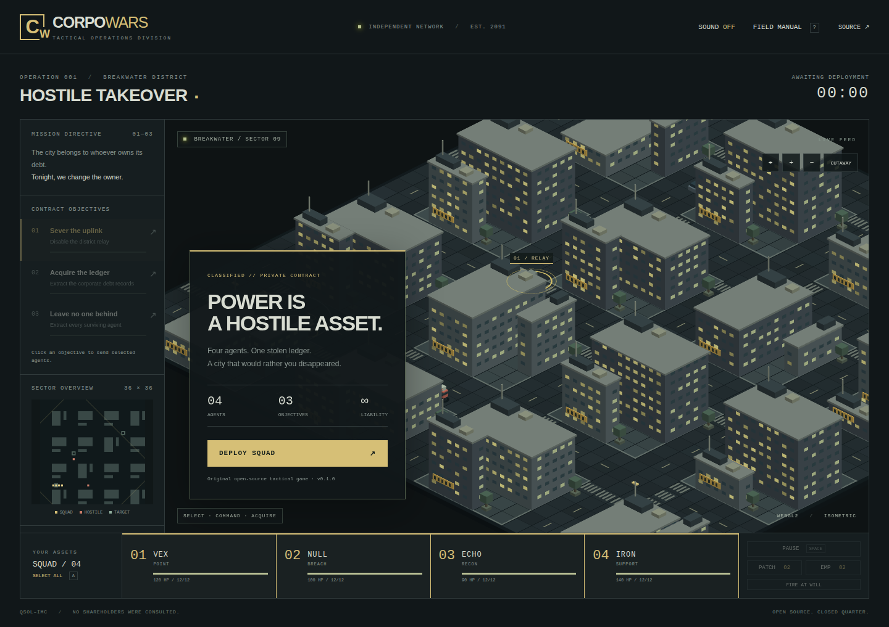

# CorpoWars

**The city belongs to whoever owns its debt. Tonight, we change the owner.**

Original, open-source isometric squad tactics for web browsers. Plain HTML, CSS,
JavaScript modules, and native WebGL2. No game engine, runtime packages, account,
server, asset downloads, or build step required to play a hosted copy.

**[Play CorpoWars](https://qsolkcb.github.io/CorpoWars/)** ·
[Get started](GETTING_STARTED.md) · [Field manual](INSTRUCTIONS.md)

## v0.1.0 — Hostile Takeover

Command four agents through a complete original mission in Breakwater: disable
the district relay, steal a corporate debt ledger, and extract every survivor.

- Procedural isometric city, shaded buildings, original geometric agents,
  decorative traffic, tactical minimap, and building cutaway.
- Squad and individual orders, formation destinations, grid pathfinding,
  wall-aware gunfire, guard patrols, automatic weapons and reloading.
- Tactical pause, trauma patches, EMP, hold fire, victory/loss, restart,
  and optional synthesised sound. Local best completion time when storage allows.
- Mouse, keyboard, and on-screen controls; responsive layout for smaller screens.

This is a **playable first mission**, not a feature-complete Syndicate remake.
Campaign strategy, research, controllable vehicles, interiors, save games, and
multiplayer are future work. WebGL2 is required; unsupported browsers receive
an explanatory error. Chromium is the automated browser target; other browser
and physical mobile/GPU combinations need further validation.

## Originality and licence

Inspired by the genre of Syndicate and [FreeSynd](https://freesynd.sourceforge.io/),
with independently written code and original procedural visuals, map, fiction,
and synthesised audio. No original game assets or FreeSynd source code are used.
No copy of Syndicate is required. Unaffiliated with EA, Bullfrog, or FreeSynd.

Your existing [Apache 2.0 licence](LICENSE) applies. See [NOTICE](NOTICE),
[asset provenance](docs/ASSET_PROVENANCE.md), [architecture](docs/ARCHITECTURE.md),
[roadmap](ROADMAP.md), and [release notes](docs/RELEASE_NOTES_v0.1.0.md).

Built for QSOL-IMC / Trent Slade with OpenAI Codex.
