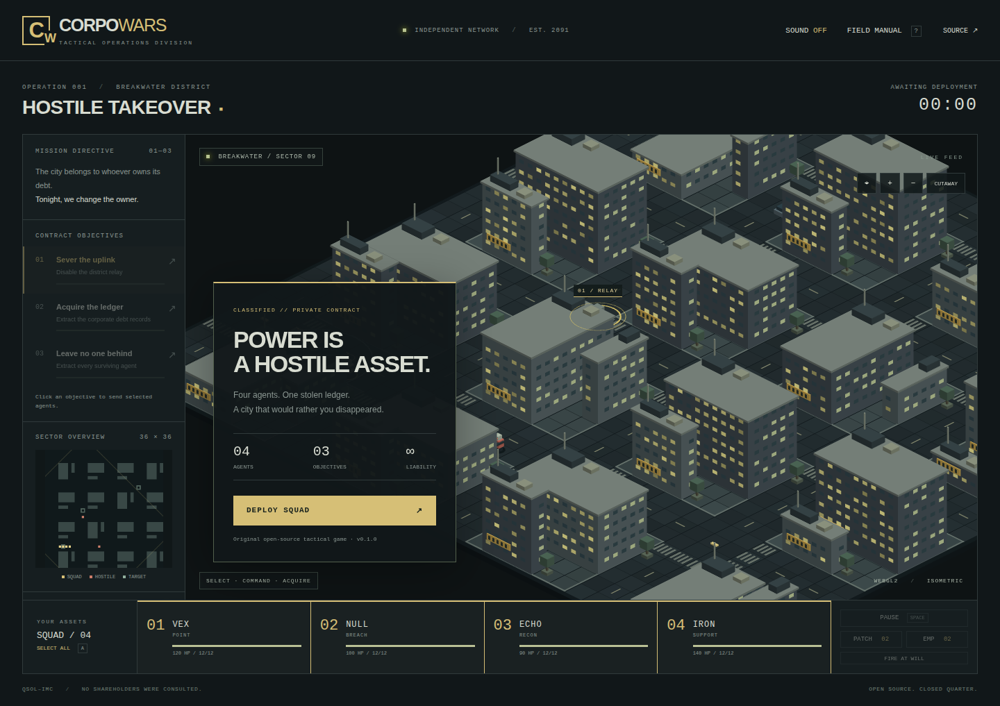

# CorpoWars

**The city belongs to whoever owns its debt. Tonight, we change the owner.**

Original, open-source isometric squad tactics for web browsers. Plain HTML, CSS,
JavaScript modules, and native WebGL2. No game engine, runtime packages, account,
server, asset downloads, or build step required to play a hosted copy.

**[Play CorpoWars](https://qsolkcb.github.io/CorpoWars/)** ·
[Get started](GETTING_STARTED.md) · [Field manual](INSTRUCTIONS.md)

## v0.4.1 — Human Resources

The squad and security have new faceted character models: rounded helmets,
shaped armour, articulated limbs, sloped boots, segmented visors and clearer
weapons. Bulwark shields, Marksman optics and the courier's hard case retain
distinct silhouettes. Soft contact shadows replace the dense old shadow rings.

The models stay in the existing scene batch with the same shaders and draw
passes. Each role fits within its v0.4.0 vertex budget; CPU preparation and cold
startup are measured separately. Tactical markers, routes, health bars, city
geometry and gameplay remain unchanged. See the
[visual polish contract and measurements](docs/VISUAL_POLISH.md) and
[v0.4.1 notes](docs/RELEASE_NOTES_v0.4.1.md).

## v0.4.0 — Hostile Expansion

The campaign now has **six contracts**, with three new district layouts and
different tactical objectives:

| Contract | District | Challenge |
| --- | --- | --- |
| Signal Siege | Copperline Grid | Hold an uncontested transmitter against two security waves |
| Witness Protection | Cold Storage | Release and protect a vulnerable courier all the way to extraction |
| Golden Parachute | Obsidian Exchange | Seize the severance fund and escape before lockdown |

Bulwarks bring heavy armour and shields; Marksmen engage from longer range.
The new districts have distinct procedural palettes and rooftop machinery.
Every contract also offers three optional badges for a full squad extraction,
winning without abilities, and beating its par time. Badges persist separately
by contract and difficulty without paying duplicate credits.

Existing campaign saves carry forward. Finish the original three contracts,
then choose Signal Siege in **Research & Loadout**. The new **Escort courier**
button / **C** handles automatic accompaniment after release. See the updated
[field manual](INSTRUCTIONS.md) and [v0.4.0 notes](docs/RELEASE_NOTES_v0.4.0.md).

## VANILLAJS performance upgrade

The renderer now uses direct typed-array geometry, retained scene/overlay
buffers, WebGL2 vertex arrays and exact reuse during unchanged frames. Stable
heap navigation, quieter HUD updates and a retained radar background reduce CPU
work while preserving the campaign, visuals and route choices. No runtime
dependencies or new game content are introduced.

Local CPU workloads reduced active renderer preparation by about 46%, changing
combat preparation by 60%, and 1,200-path preparation by 81%. These are measured
preparation workloads, not FPS claims. See the complete
[performance contract, raw measurements and memory tradeoff](docs/PERFORMANCE.md).
Those measurements record the PR #3 optimization baseline; expansion districts
add their own geometry while the original scene parity checks remain enforced.

## v0.3.0 — Corporate Dissolution

Two new development slices extend the original mission into a three-contract
campaign. Play **Hostile Takeover**, **Ghost Shift** and **Boardroom Blackout**
in three original district layouts, with different entry points, objectives,
extraction routes and security deployments.

- **6,000 starting credits** shared between per-agent weapons and permanent
  squad research. First completions pay 2,400 / 3,200 / 4,000 credits; replays
  never duplicate rewards. Equipment, research and contract progress save locally.
- **Owen Gun (9mm), AUG (.223 / 9mm / .300 Blackout) and Over & Under (12g)**.
  Each has its own magazine, firing rhythm and reload. AUG switching costs a
  full reload. These are fictional game configurations and balance values.
- **Research tree:** two medical upgrades; head, arms, torso and leg
  augmentations; two panic upgrades, with visible costs and prerequisites.
- **Panic**, rather than persuasion: selected agents emit a rechargeable field
  that makes visible enemies retreat without firing. It never recruits enemies.
- **Relaxed** retains the original forgiving combat balance. **Hostile** adds
  four guards, more health, faster pursuit and fire, and panic resistance.
- **WASD camera**, Q select-all, mouse pan pad, middle-drag, radar click-to-pan,
  and optional squad follow. Radar sits at the battlefield's top left; compact
  objectives remain above it. The desktop HUD fits the window.
- Interpolated movement, smooth camera focus, reusable dynamic graphics buffers,
  static building shadows, health indicators, shot impacts and an Eco option.
- Original mathematical tracker soundtrack: pulse arpeggios, triangle bass,
  generated percussion and evolving arrangements for briefing, patrol and combat.
  Music and sound effects are separately opt-in, with a music volume slider.

Plain HTML/CSS/JS and native WebGL2 remain the entire game runtime. No downloaded
assets or third-party runtime packages. WebGL2 is required; unsupported devices
receive an explanatory error. Chromium is the automated browser target. Physical
mobile, Firefox, Safari and multiple GPU/driver combinations need further validation.

Campaign saves persist purchases and completed contracts, **not in-mission
positions**. There is no backend, cloud account, vehicle control, interior
simulation or multiplayer. See [v0.3.0 release notes](docs/RELEASE_NOTES_v0.3.0.md).

## Originality and licence

Inspired by the genre of Syndicate and [FreeSynd](https://freesynd.sourceforge.io/),
with independently written code and original procedural visuals, map, fiction,
and synthesised audio. No original game assets or FreeSynd source code are used.
No copy of Syndicate is required. Unaffiliated with EA, Bullfrog, or FreeSynd.

Your existing [Apache 2.0 licence](LICENSE) applies. See [NOTICE](NOTICE),
[asset provenance](docs/ASSET_PROVENANCE.md), [architecture](docs/ARCHITECTURE.md),
[roadmap](ROADMAP.md), and [release notes](docs/RELEASE_NOTES_v0.1.0.md).

Built for QSOL-IMC / Trent Slade with OpenAI Codex.
